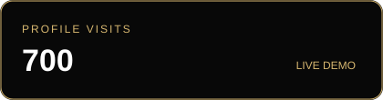

# RAFAT AHMED

### FULL-STACK DEVELOPER & DIGITAL BUILDER

 

  

[ABOUT](#about) · [EXPERTISE](#expertise) · [TECHNOLOGIES](#technologies) · [SHOWCASE](#developer-showcase) · [ACTIVITY](#activity) · [CONNECT](#connect)

---

## ABOUT

Hello, I'm **Rafat Ahmed** — a full-stack developer who enjoys turning ideas into thoughtful digital experiences.

I believe the best products are not always the ones with the most features. They are the ones that solve a real problem, feel natural to use, and make even complex things feel simple.

I enjoy working across the entire development process — from shaping an idea and designing its interface to building the systems that make it work.

For me, development is more than writing code. It's about understanding people, solving problems, and creating something worth using.

**"Build something meaningful. Make every detail count."**

### My approach

- **Purpose first:** Understand the problem before building the solution.
- **Design matters:** Good functionality deserves a thoughtful interface.
- **Keep it simple:** Clean solutions are easier to use and maintain.
- **Details matter:** Small improvements can make a big difference.
- **Never stop learning:** Every challenge is an opportunity to grow.

---

## EXPERTISE

<table>
<tr>
<td width="50%" valign="top">

### 01 / Frontend Engineering

Creating responsive and polished interfaces.

- Modern web interfaces
- Component-based development
- Responsive layouts
- Interactive experiences
- UI implementation

</td>
<td width="50%" valign="top">

### 02 / Backend Engineering

Building the systems behind digital products.

- Backend logic
- API integration
- Authentication
- Database management
- Data storage

</td>
</tr>
<tr>
<td width="50%" valign="top">

### 03 / Mobile Development

Exploring useful and natural mobile experiences.

- Android development
- Cross-platform applications
- Mobile UI
- App architecture
- Data integration

</td>
<td width="50%" valign="top">

### 04 / Product & Interface Design

Thinking beyond code to improve the user experience.

- UI structure
- Visual consistency
- User experience
- Interaction details
- Design systems

</td>
</tr>
</table>

---

## TECHNOLOGIES

### Programming Languages

### Frontend & Frameworks

### Mobile Technologies

### Backend & Databases

### Tools & Platforms

---

## DESIGN PHILOSOPHY

I appreciate design that feels intentional.

Clean layouts, balanced spacing, simple navigation, thoughtful interactions, and details that make an experience feel complete.

I prefer products that feel effortless to use rather than interfaces that try too hard to impress.

---

## DEVELOPER SHOWCASE

Experimental profile dashboard — simulated data for visual testing, not verified GitHub achievements.

  

<table>
<tr>
<td align="center" width="33%">

### 684+

**Simulated Visits**

Demo counter

</td>
<td align="center" width="33%">

### 128+

**Demo Projects**

Sample metric

</td>
<td align="center" width="33%">

### 42+

**Demo Milestones**

Sample metric

</td>
</tr>
</table>

### DEMO ACHIEVEMENTS

---

## ACTIVITY

### Contribution Overview

### Contribution Snake

<picture>
<source media="(prefers-color-scheme: dark)" srcset="https://raw.githubusercontent.com/RafatVerse/RafatVerse/output/github-contribution-grid-snake-dark.svg" />
<source media="(prefers-color-scheme: light)" srcset="https://raw.githubusercontent.com/RafatVerse/RafatVerse/output/github-contribution-grid-snake.svg" />

</picture>

---

## BEYOND THE CODE

I enjoy the creative side of technology as much as the technical side.

I like exploring new ideas, studying well-designed products, learning from other developers, and finding better ways to turn a concept into something real.

My interests include:

- **Creative design** — thoughtful layouts and visual details.
- **Technology** — tools and ideas that make building better.
- **Problem solving** — finding simple answers to difficult problems.
- **Continuous growth** — becoming better through practice.

---

## CURRENT DIRECTION

My focus is on becoming a stronger developer through real projects and consistent learning.

I want to build products that are useful, reliable, beautiful, and enjoyable to use.

Not just more code. Better work.

**THINK CLEARLY. BUILD CAREFULLY. KEEP MOVING.**

---

## CONNECT

  

**Rafat Ahmed · @RafatVerse**

